# Virtuoso Optimizer 1.7.0 界面改版评估

- 日期：2026-11-01
- 环境：CentOS 7 虚拟机（Virtuoso IC618），XMC 55RFSOI 1P5M2T 工艺库（真实 PDK 路径）
- 测试工作区：`/home/IC/_stage/ws_test`；测试器件：八角 3 圈电感，外径 160 µm
- 对照版本：虚拟机桌面 `optimizer_versions/optimizer_v08c`
- 方式：全部在本地虚拟机实际操作并截图；**未推送仓库、未打包/更新 kit、未改版本号**
- 截图目录：`docs/ui_eval_2026-11-01/shots/`

## 0. 结论

- 「环境 / 设计 / 变量 / 目标 / 迭代」五个标签页已按 08c 收敛为同样的字段集，没有多出来需要填的栏位。
- 「仿真设置」标签页已删除；原有的保存原始数据、仿真超时留在「迭代」页。
- 「版图」与 EM 相关页已拆开：版图页只做图形参数、出图与截图；EM 仿真、对齐、融合各在自己的页。
- 版图示意图完整显示外形、两个端口、宽/高尺寸与参数行，参数文字不再被输入框遮住。
- 端到端实测通过：工艺检查（真实 PDK）→ 仅出图生成 `LIBRF/ind_demo` → 导出 GDS → EM 页自动填入 → 渲染截图得到 PNG。

## 1. 本次改动的逐项说明（测试方法 + 结果 + 截图）

### 1.1 环境页与 08c 对齐

**说明**：只保留 7 行环境变量（spectre 程序、virtuoso 程序、CADHOME、CDS、SPECTRE_HOME、CDS_LIC_FILE、PATH 追加），每行右侧就地写明用途；下面是一张选填的「其他附加变量」多行框，按 `KEY=VALUE` 每行一个。

**怎么测**：打开「环境」页，逐行对照 08c 的同一页；改一行再点「自动探测」「自检报告」，确认提示与按钮都在。

**结果**：字段与 08c 一致，没有额外的必填项；说明文字贴在对应行右侧，不需要再靠弹窗猜。

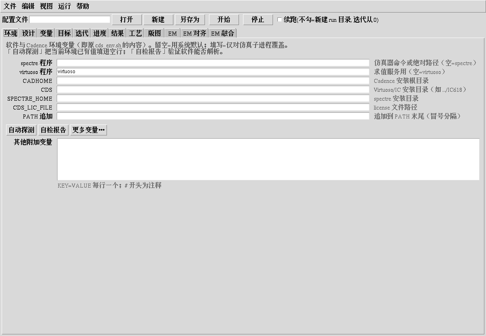

### 1.2 设计页与 08c 对齐

**说明**：主表单只保留 9 项：库、单元、视图、状态名、状态目录、工作目录、网表文件、输出目录、分析。不常用的任务名称、网表视图、网表根目录收进「高级…」；网表视图默认显示「跟随「视图」」，不让下拉框看起来像还要填的空栏。

**怎么测**：打开「设计」页核对 9 行；点「高级…」确认次要项都在、网表视图有三项可选；选一项后关闭再打开，确认选择保留；点「关闭」回到主表单。

**结果**：可见字段与 08c 相同，右侧「浏览 / [?]」的排列也一致；主表单不再有多余输入框；页底一行说明写清了导入 ADEL 后变量与输出名的去向。「高级…」窗口只有任务名称、网表视图、网表根目录三项（另有「探查 ADE 状态目录…」与「关闭」），说明文字完整不被遮挡；网表视图下拉为「跟随「视图」/ schematic / config」，默认选中「跟随「视图」」，选 schematic 后框内立即更新，关闭再打开仍是 schematic。

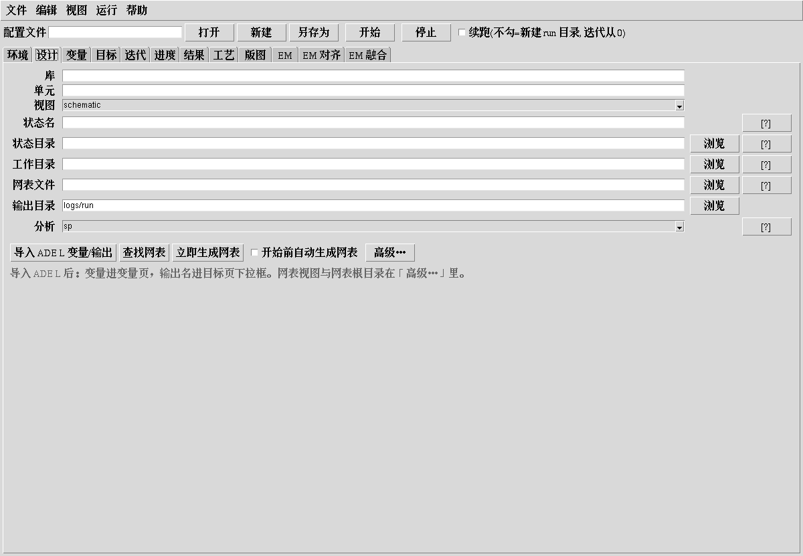

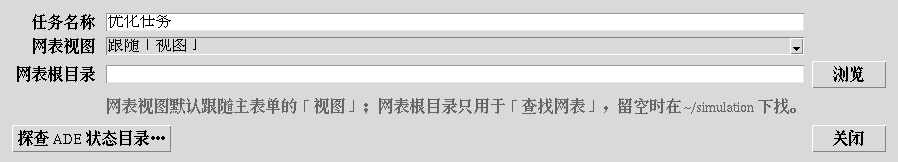

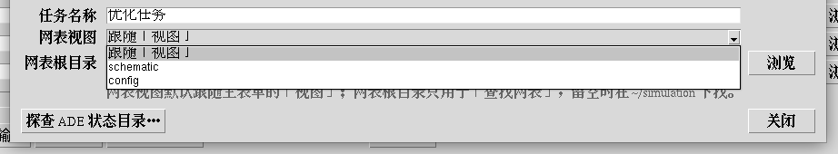

### 1.3 变量页

**说明**：上半区是参与优化的变量表（名称 / 初值 / 最小 / 最大），下半区是不参与优化的固定变量表（名称 / 值），各自带一行添加栏和操作按钮。

**怎么测**：在添加栏填名称与数值 → 添加；选中一行 → 更新 / 删除 / 移至固定（或移至优化）；试一次撤销/重做。

**结果**：两张表各自独立，快捷键提示（Del 删除、Ctrl+Z 撤销、Ctrl+Y 重做）就在按钮旁；没有出现需要额外理解的新栏位。

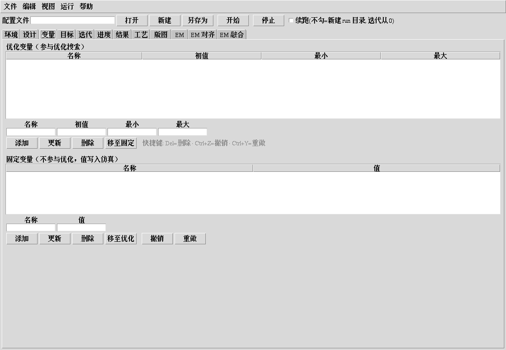

### 1.4 目标页

**说明**：一张 10 列表格（输出 / 指标 / 算子 / 目标 / 目标2 / 容差 / 权重 / 频段下 / 频段上 / 频率），下面是添加行与「添加 / 添加上下界 / 更新 / 删除 / 限值曲线… / 字段说明」按钮。

**怎么测**：添加一条目标；用「添加上下界」生成目标2；点「字段说明」看各列含义；点「限值曲线…」打开逐点编辑。

**结果**：表格与添加行一一对应，页底三行说明解释了一条目标与多条目标如何合成总误差；操作路径与 08c 相同。

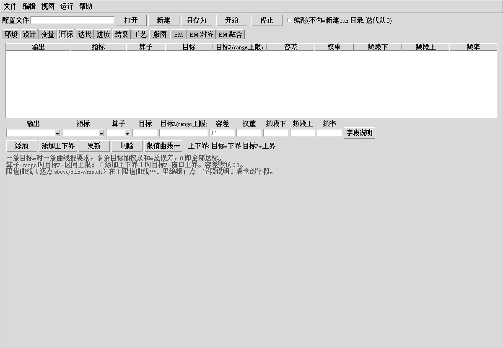

### 1.5 迭代页与删除「仿真设置」标签页

**说明**：迭代页保留 7 项搜索设置（最大迭代、停滞耐心、改进阈值、失败上限、最大重启、随机种子、搜索策略）、「仿真选项」（保存原始数据 1/2/0、仿真超时秒）、「查看 ADE 设置…」和右侧 4 个帮助小标签。原来独立的「仿真设置」标签页不再存在。

**怎么测**：看顶部标签条是否还有「仿真设置」；在迭代页修改保存原始数据与超时；点「查看 ADE 设置…」看只读快照。

**结果**：标签条为 环境 / 设计 / 变量 / 目标 / 迭代 / 进度 / 结果 / 工艺 / 版图 / EM / EM 对齐 / EM 融合，共 12 个，没有「仿真设置」；仿真选项仍可在迭代页设置；ADE 快照为只读，不修改 ADE。

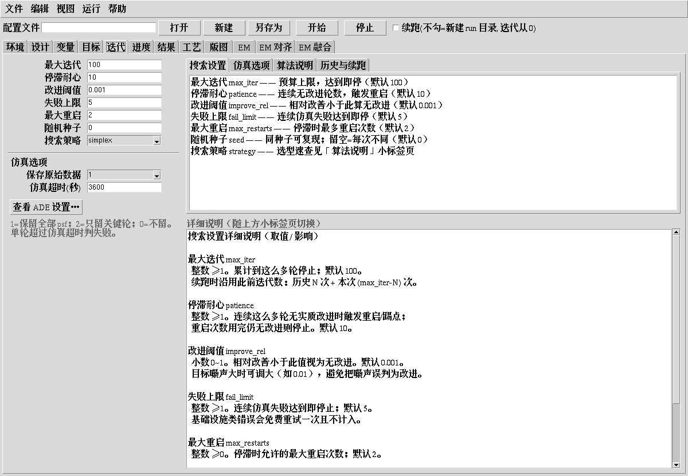

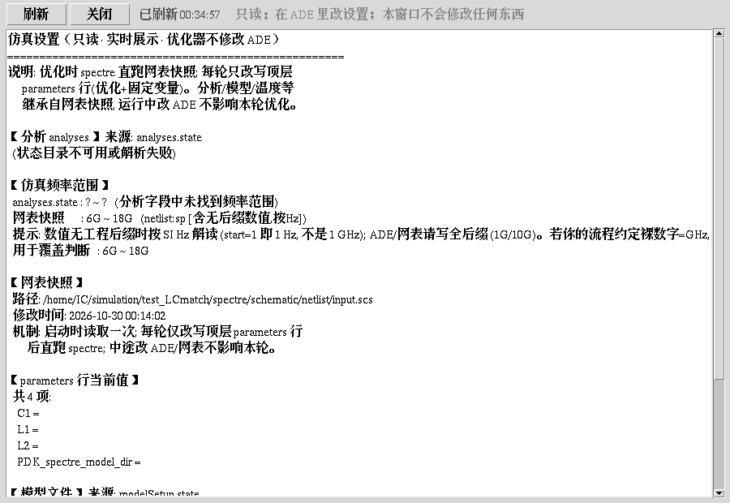

### 1.6 版图页与 EM 页分开

**说明**：版图页只保留图形相关输入（cds.lib、器件类型、几何字段、cell 名、views 模式）和「仅出图 / 出图+EM+views / 渲染截图」三个按钮及运行日志；EM 频率、EMX 精度、端口/求解等全部在「EM」页，EM 页内再分「EM 仿真」「EM 优化迭代」两个子标签。

**怎么测**：在版图页从上到下检查是否还有 EM 参数；到 EM 页确认参数齐全；在版图页执行一次「仅出图」，再回 EM 页看是否自动填入 cell、GDS 路径、工作目录与 proc。

**结果**：两页职责清楚，版图页没有 EM 设置；出图后 EM 页的 cell=ind_demo、GDS=`/home/IC/_stage/ws_test/ind_demo.gds`、工作目录=`/home/IC/_stage/ws_test` 已自动填好，proc 只读显示工艺页选中的文件。

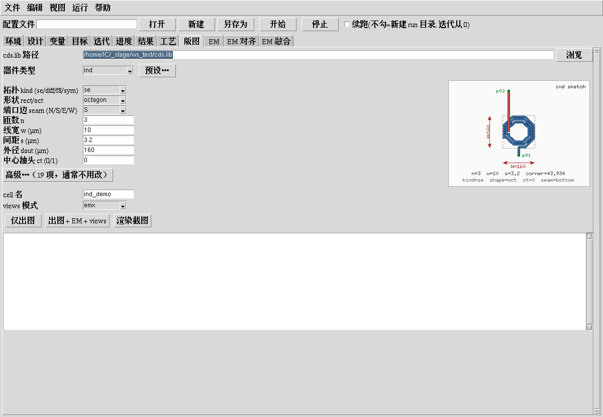

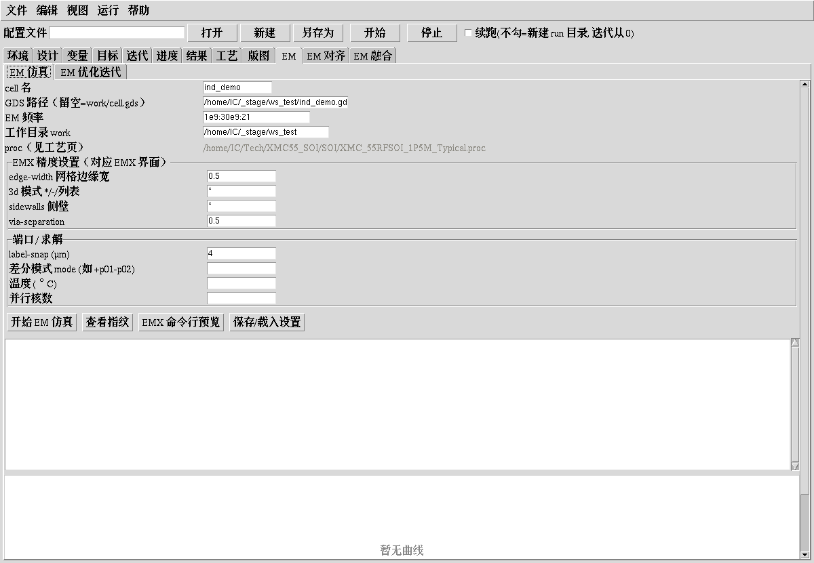

### 1.7 版图示意图

**说明**：示意图按器件全部图形（含端口引线、underpass、过孔）取外廓缩放并居中；端口名标在引线侧面；宽/高尺寸标在外侧；两行器件参数放在图内底部，不再被左侧输入框压住。

**怎么测**：版图页设 器件类型=ind、形状=octagon、圈数 n=3、线宽 w=10、间距 s=3.2、外径 dout=160，观察右侧示意图与参数行。

**结果**：图形完整不裁边；p02 在上、p01 在下，标签不被遮挡；`H=160`、`W=160` 清楚可读；参数行 `n=3 w=10 s=3.2 corner=43.934` 与 `kind=se shape=oct ct=0 seam=bottom` 完整显示。

### 1.8 「高级…（19 项）」窗口

**说明**：不常用的 19 个几何字段收进单独的「高级几何参数」窗口，主表单只留 8 个常用项；改动会立即反映到示意图与出图几何。

**怎么测**：点「高级…（19 项，通常不用改）」，改「端口夹角」或「lead_len」，看示意图与参数行是否随之变化，再关闭窗口。

**结果**：19 个字段都能填，标签与数值完整；窗口大小合适；关闭后主表单不受影响。

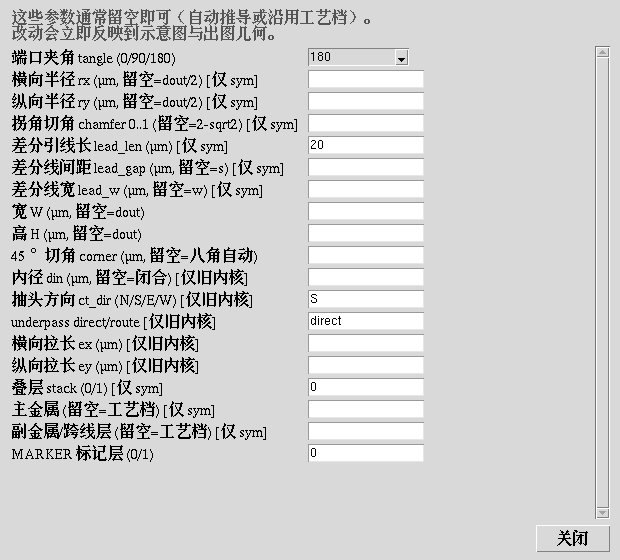

### 1.9 工艺检查（真实 PDK）

**说明**：开始版图/EM 任务前自动执行工艺检查（路径存在性 → layermap/proc 解析 → 叠层与层号核对），硬错误直接中止任务；也可手动点「检查工艺」，结果写在下方明细框。

**怎么测**：工艺页填 工艺库名=55RFSOI、工艺库目录=`.../XMC55_SOI_XR1.2/1P5M2T_5Ic_ALPA2/55RFSOI`、layermap=`.../55RFSOI/55RFSOI.layermap`、EMX proc=`.../XMC_55RFSOI_1P5M_Typical.proc`，点「检查工艺」。

**结果**：状态显示「通过（1 条警告）」，明细完整显示「工艺检查通过，1 条警告：cds.lib（工作区库映射）未配置/不可用（未填）；将回退默认探查或自动生成」。不填工艺库目录时检查会明确列出缺少的层，任务不会继续。

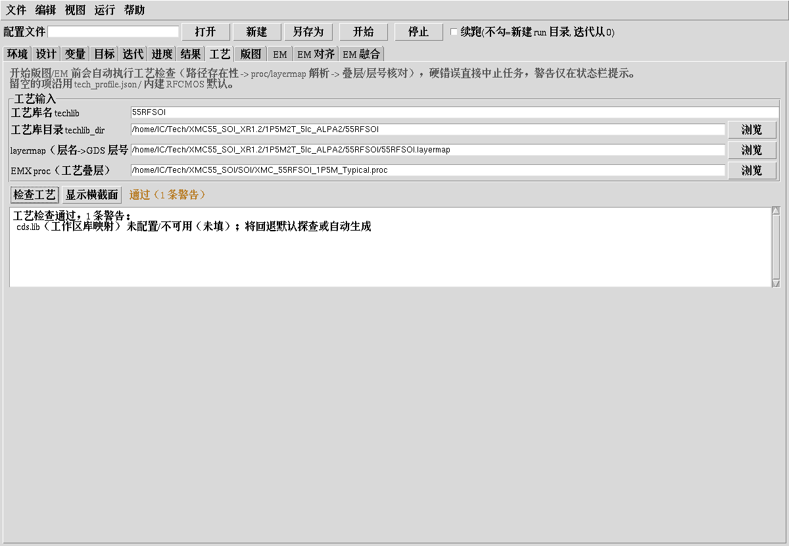

### 1.10 仅出图（端到端）

**说明**：「仅出图」按当前几何生成 Virtuoso 版图 cell、导出 GDS，并把结果联动到 EM 页。

**怎么测**：设计页工作目录填 `/home/IC/_stage/ws_test`；版图页 cell 名填 `ind_demo`；点「仅出图」。

**结果**：日志依次给出：任务开始、后台执行、`完成 cell=LIBRF/ind_demo bbox=[-80.0, -95.167, 80.0, 155.0]`、`端口: p01, p02`、GDS 路径、`已联动填入 EM 仿真页参数`。没有报错，EM 页自动填好（见 1.6）。

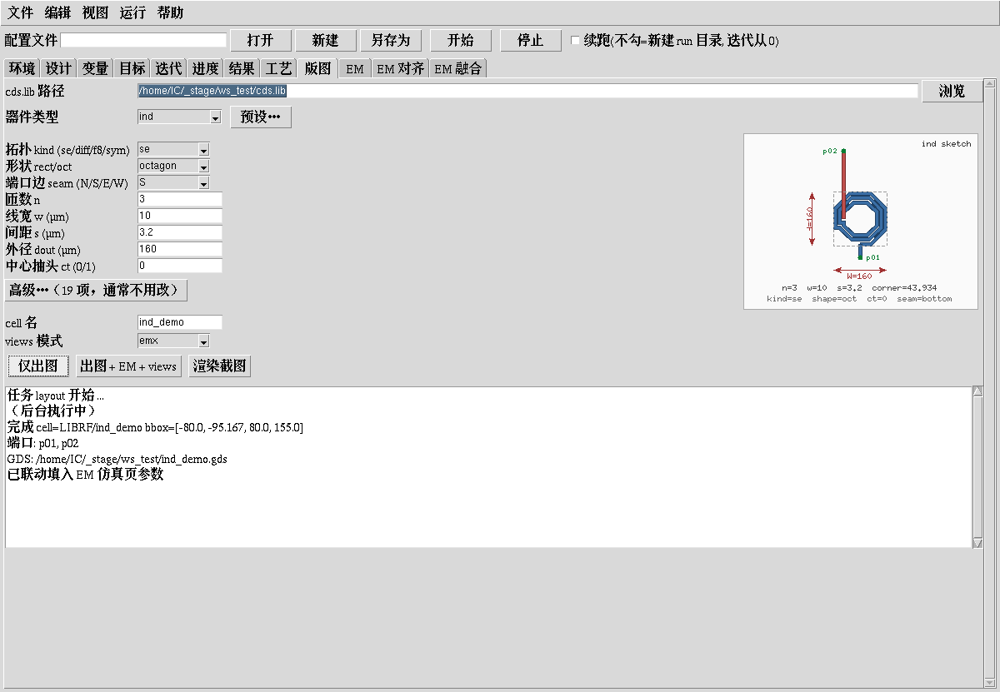

### 1.11 渲染截图

**说明**：出图后把 GDS 渲染成同名 PNG（按工艺层配色），并在屏幕上打开查看器。

**怎么测**：版图页点「渲染截图」。

**结果**：日志追加 `截图: /home/IC/_stage/ws_test/ind_demo.png`，查看器显示八角螺旋、紫色 underpass 与上下两个端口；PNG 尺寸 561×901。

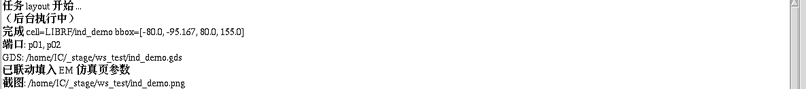

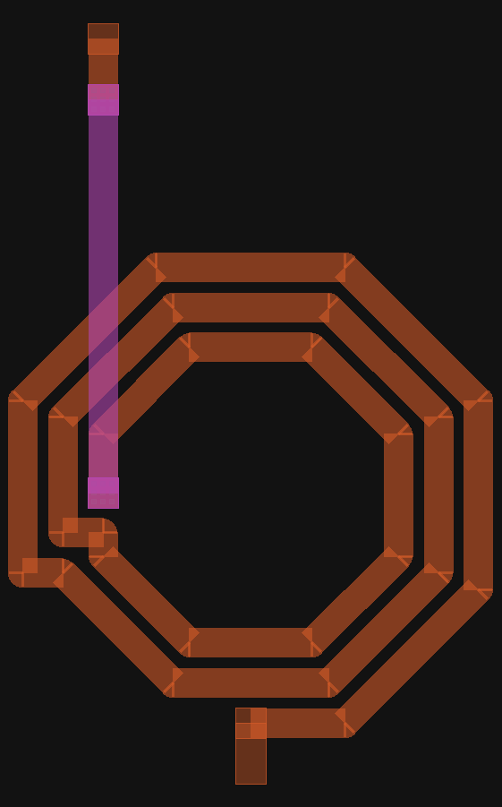

### 1.12 EMX 命令行预览

**说明**：按当前 EM 设置拼出等效 emx 命令，长命令自动换行，方便核对参数是否带全。

**怎么测**：EM 页点「EMX 命令行预览」。

**结果**：命令在日志框内换行完整显示，proc 路径、频率向量等都在，末尾的频点没有被截掉。

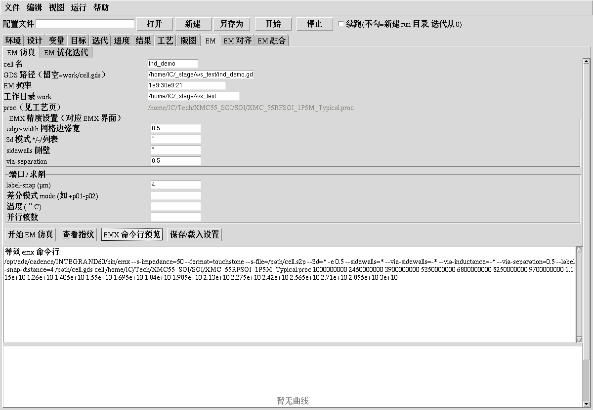

### 1.13 EM 对齐（保持可用）

**说明**：EM 对齐页仍是独立的一页，用来把第一阶段结果与 EM 结果对齐。

**怎么测**：在 EM 对齐页填第一阶段 run 目录、EM 曲线文件或 EM 网表，点「开始 EM 对齐」。

**结果**：按钮、进度日志、对齐报告两个区域都正常，状态显示「就绪」；本次没有完整跑对齐流程（需要第一阶段结果文件），页面逻辑不受版图/EM 拆分影响。

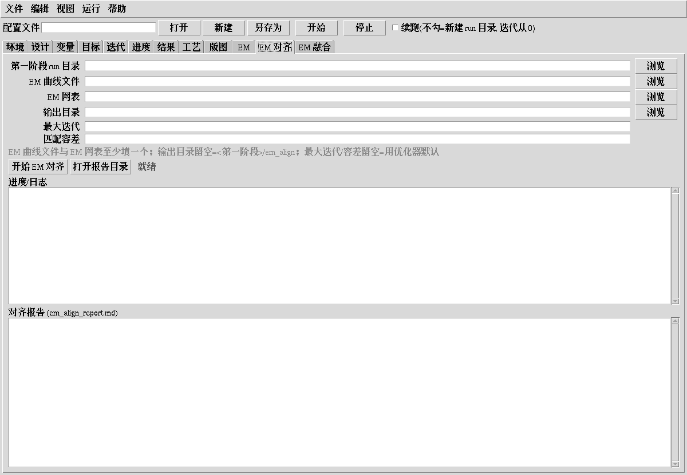

### 1.14 EM 融合（只读看板）

**说明**：EM 融合页只读展示库统计、查询记录、EM 优化器状态与告警，不修改 ADE。

**怎么测**：打开 EM 融合页，等自动刷新（2 秒）或点「手动刷新」。

**结果**：各分区都有空态说明（如「暂无查询记录」「无告警」），时间戳随刷新更新。

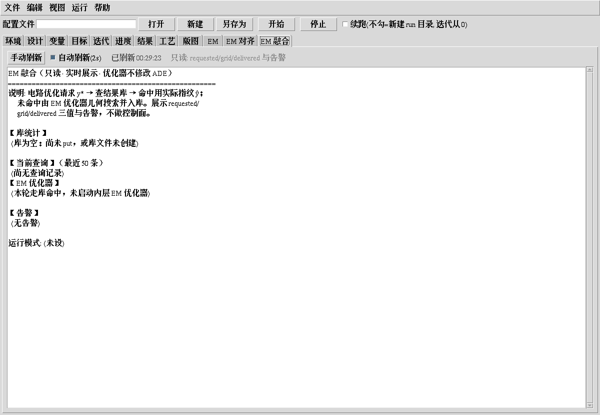

### 1.15 滚轮与空态提示

**说明**：滚轮只作用于当前显示的页；落在日志/表格上时只滚动该控件。EM 仿真页的曲线区在无数据时显示「暂无曲线」，不再是一块空白面板。

**怎么测**：在版图页滚到底后切到 EM 页，确认 EM 页仍在顶部；在日志框上滚动，确认只滚日志；下滚 EM 页查看曲线区提示。

**结果**：切页后不再被上一页的滚轮位置带偏；曲线区中央显示「暂无曲线」。

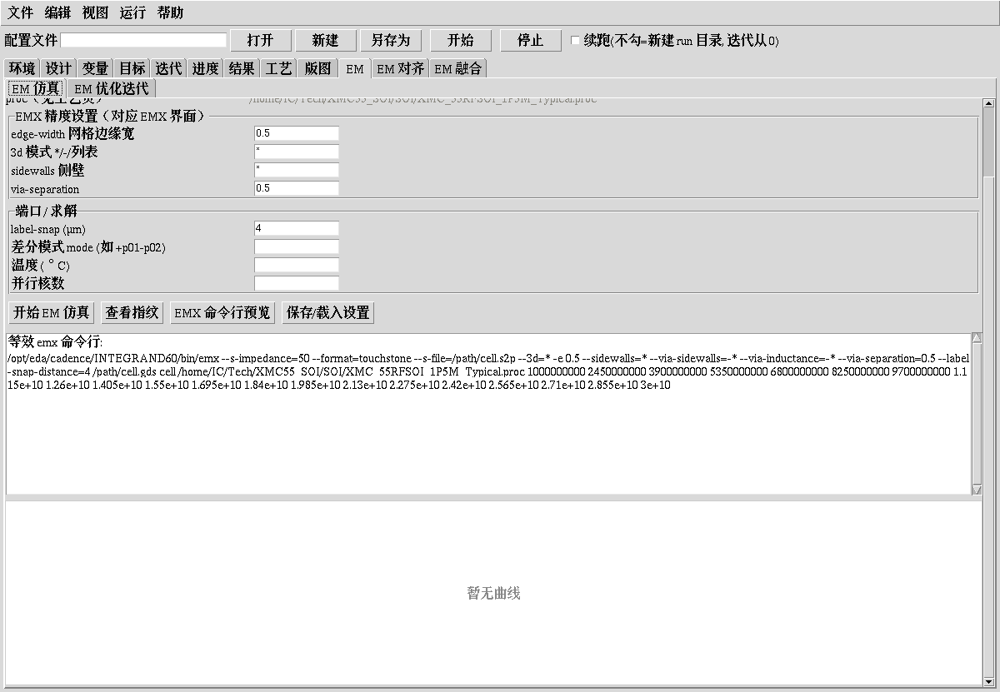

## 2. 之前已实现功能的评估方法（回归清单）

| 功能 | 用户怎么操作 | 通过判据 |
|---|---|---|
| 工艺检查门禁 | 工艺页填 4 个路径 → 「检查工艺」；不填时直接开始任务 | 状态显示「通过 / 通过（N 条警告）」；缺层时列出缺失角色与层名，任务在开始处中止 |
| cds.lib 单一入口 | 版图页查看 cds.lib；改设计页工作目录 | cds.lib 只出现在版图页一处，路径随工作目录同步；运行后工作区生成库映射 |
| 导入 ADEL | 设计页填状态目录/状态名 → 「导入 ADEL」 | 变量进「变量」页，输出名进「目标」页下拉 |
| 查找网表 / 立即生成网表 | 设计页点对应按钮 | 网表文件字段被填入或重新生成；勾选「开始前自动生成网表」后开始任务会先重建 |
| 设计页「高级…」 | 设计页点「高级…」 | 任务名称、网表视图（默认「跟随「视图」」）、网表根目录可查看可修改，关闭再打开仍在 |
| 版图预设 | 版图页点「预设…」选一项 | 几何表单与示意图立即更新 |
| ADE 设置快照 | 迭代页点「查看 ADE 设置…」 | 只读窗口显示分析来源、频率范围、网表快照、parameters 当前值；「刷新」更新时间；不修改 ADE |
| proc 单一来源 | 只在工艺页选 proc | EM 页只读显示同一路径；改工艺页后 EM 页同步 |
| EM 对齐 | EM 对齐页填第一阶段 run 目录等 → 「开始 EM 对齐」 | 进度日志滚动，报告区生成对齐报告，状态「就绪」 |
| EM 融合 | 打开 EM 融合页（自动刷新 2 秒 / 手动刷新） | 库统计、当前查询、EM 优化器、告警、运行模式五段有内容或空态说明 |
| EM 优化迭代 | EM 页「EM 优化迭代」子标签勾选启用 → 「开始 EM 优化」 | 几何变量并入优化变量；每轮自动重生成版图与 EM |
| 续跑 | 工具栏勾选「续跑(不勾=新建 run 目录,迭代从0)」后开始 | 日志显示沿用历史迭代数，不新建 run 目录 |
| 工艺横截面 | 工艺页点「显示横截面」 | 下方渲染出工艺叠层剖面 |
| 仅出图 / 出图+EM+views | 版图页填 cell 名 → 点按钮 | 完成日志含 bbox 与端口；导出 GDS 并联动 EM 页；出图+EM+views 额外生成 views/sNp |
| 渲染截图 | 版图页点「渲染截图」 | 日志出现「截图: …png」，查看器打开渲染图 |
| 页内滚轮 | 在目标页滚动；在日志框上滚动 | 只滚动当前页；日志框上只滚日志 |
| 安装后自检 | `python optimizer.py --selftest`、`python3 src/librf_opt.py --selftest`、`python optimizer.py --gui-smoke` | 179 tests OK / 124 ok, 0 fail / GUI_SMOKE_OK |

## 3. 检查截图时发现并修好的问题

1. **工艺明细框字体与首行裁切**：明细框用了系统未安装的字体，回退成 8px 点阵，字号明显小于其它控件，首行上半截被裁掉。改为跟随界面字体并留出内边距，复测两行完整（图 07 为修复后）。
2. **EM 曲线区空白面板**：无数据时整块空白，容易被当成多余输入区。补了「暂无曲线」提示（图 17）。
3. **高级参数窗口「首行像被裁」**：复核为截屏偏移造成的假象，按窗口重新截图后显示完整（图 09），软件无需修改。
4. **设计页「高级…」里网表视图是空下拉框**：配置里该值为空表示跟随主表单的「视图」，但界面上只显示一个空白框，容易被当成还得填的栏位。改为显示「跟随「视图」」并与其他两项并列，选择后立即写回（图 02b、02c）。

## 4. 未覆盖与已知限制

- 没有实际运行 EMX 电磁仿真（需要 license 与较长机时），验证到参数联动与命令行预览。
- 没有在 Virtuoso 里截图确认生成的 cellview（需要工程库环境），验证到 GDS 导出与渲染图。
- 目标页「添加行」的标签与上方表格列不是逐像素对齐（沿用旧样式），但填写顺序与列顺序一致，不影响使用；本次未改动。
- 版图页 cds.lib、EM 页 GDS 路径等长路径在窗口宽度不足时只显示一部分，可点击后用方向键左右查看。

## 5. 本地状态

- 本节记录评估当时的状态：改动当时只在本地工作副本，未提交、未推送、未打包，版本号仍为 1.7.0；此后已提交并推送，当前版本为 1.7.1（见仓库 release/ 的传输脚本）。
- 自检全部通过：`optimizer.py --selftest`（179 tests OK）、`src/librf_opt.py --selftest`（124 ok, 0 fail）、`optimizer.py --gui-smoke`（GUI_SMOKE_OK）。
